# GNet Utility

A small, draggable network widget for your GNOME desktop. It sits on the wallpaper and shows what your connection looks like right now: Wi-Fi, IPs, rough location, proxy and VPN, including Tailscale.

<p align="center">
  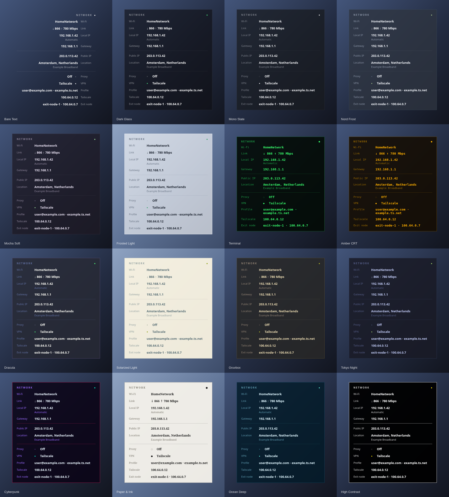
</p>

<sub>Theme previews rendered with placeholder data.</sub>

## What it shows

| Row | Details |
| --- | --- |
| **Wi-Fi** | Connected network name, or the Ethernet interface |
| **Link** | Negotiated link speed (Wi-Fi up/down rate, or Ethernet speed) |
| **Local IP** | Address, and whether it is Automatic (DHCP) or Manual |
| **Gateway** | Default gateway |
| **Public IP** | Your external address |
| **Location** | Approximate city, region and country, plus the ISP. No coordinates |
| **Proxy** | GNOME system proxy: Off, Auto (PAC) or Manual with host and port |
| **VPN** | Any active VPN: NetworkManager VPN/WireGuard, OpenVPN/wg-quick tunnels, Tailscale |
| **Tailscale** | While connected: profile, Tailscale IP and the exit node in use |

## Using it

- **Drag** with the left mouse button. The position is remembered.
- **Click** an IP, gateway or network name to copy it.
- **Right-click** for the menu: Refresh, Copy items, Theme, Settings, Kill.
- **Kill** simply disables the extension. Turn it back on from the Extensions app or with `gnome-extensions enable`.

## Install

Requires GNOME Shell 45 to 49 and NetworkManager (`nmcli`). Optional: `iw` for Wi-Fi link speed and the `tailscale` CLI for Tailscale details.

```sh
git clone https://github.com/psychoSherlock/gnet-utility.git
cd gnet-utility
make install
```

Then restart GNOME Shell (log out and back in on Wayland) and enable it:

```sh
gnome-extensions enable gnet-utility@psychosherlock
```

To remove it: `make uninstall`.

## Settings

Open them from the right-click menu, the Extensions app, or `gnome-extensions prefs gnet-utility@psychosherlock`. Changes apply instantly.

- **Appearance:** theme, alignment, width, font size, card opacity, corner radius, card border, card shadow, text shadow, title and status dot.
- **Rows:** show or hide every row individually.
- **Behaviour:** click to copy, lock position, reset position, refresh intervals, and a switch to turn the public lookup off.

## Privacy

Almost everything is read locally from NetworkManager, the kernel and the Tailscale CLI. The one exception is the public IP and location lookup: one small request to `ipinfo.io` (falling back to `ip-api.com`) every 5 minutes and on network changes. Turn it off in Settings and the widget makes no network requests at all. Nothing is stored apart from your settings in GSettings.

## Notes

- Link speed is the negotiated radio rate, not a speed test.
- Location is derived from your public IP, so it can be off by a city or more, and shows your VPN's exit point while one is active.
- The Proxy row reads GNOME's system proxy only, not terminal variables such as `http_proxy`.

## Themes

Bare Text (default), Dark Glass, Mono Slate, Nord Frost, Mocha Soft, Frosted Light, Terminal, Amber CRT, Dracula, Solarized Light, Gruvbox, Tokyo Night, Cyberpunk, Paper & Ink, Ocean Deep and High Contrast. Themes live in [`themes.js`](themes.js); adding one is a single object plus an entry in `THEME_ORDER`.

<details>
<summary>Individual previews</summary>

| | | |
| :---: | :---: | :---: |
| 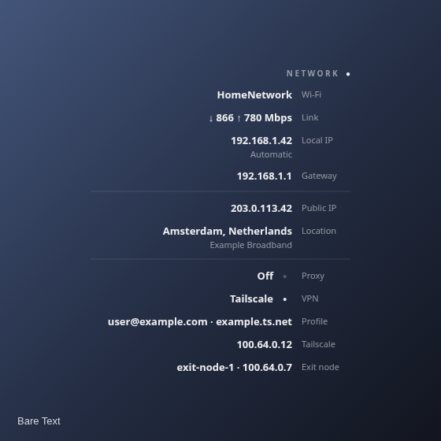 | 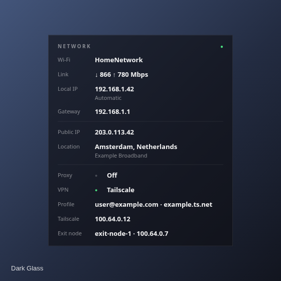 | 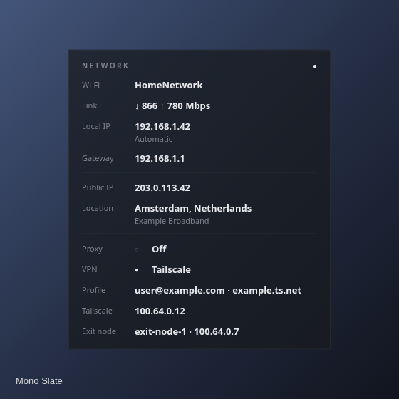 |
| 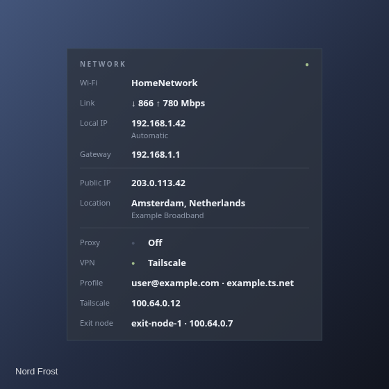 | 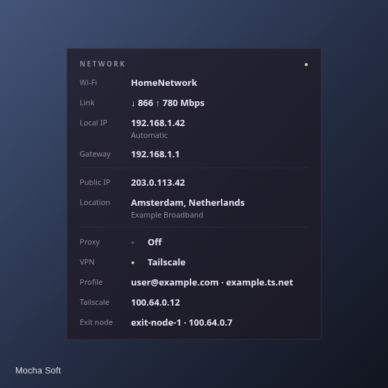 | 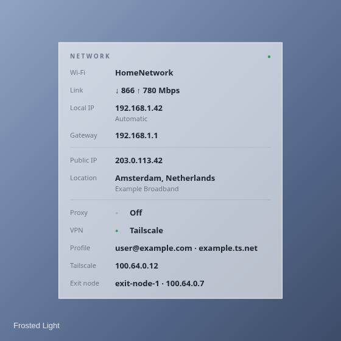 |
| 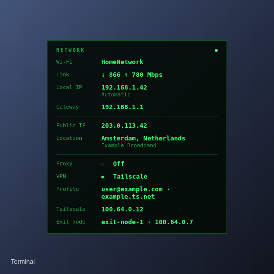 | 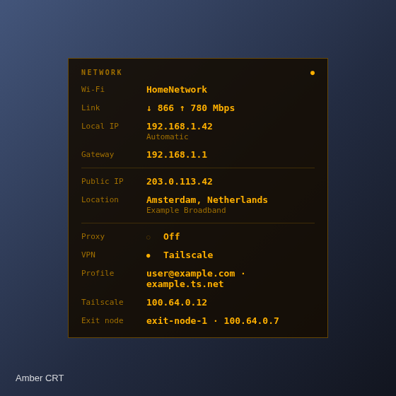 | 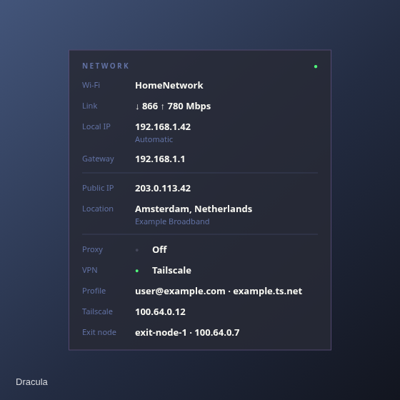 |
| 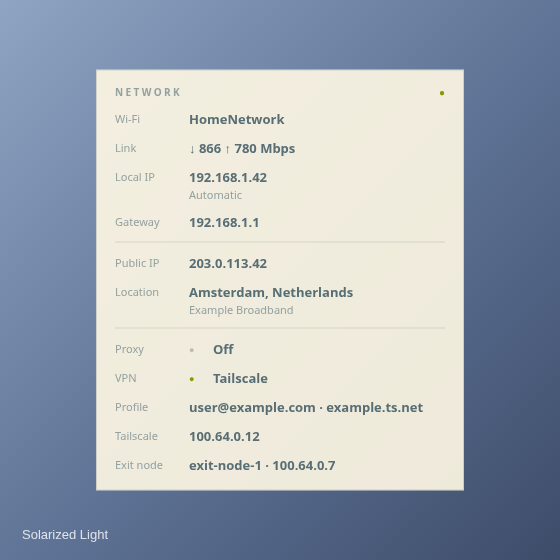 | 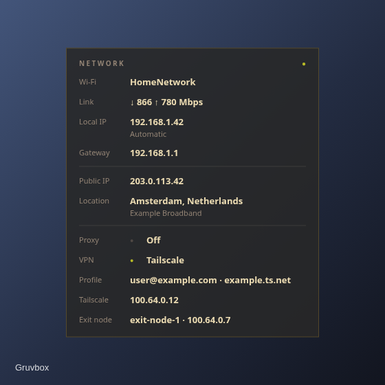 | 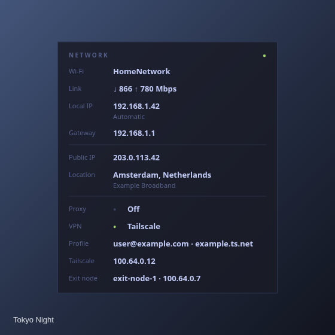 |
| 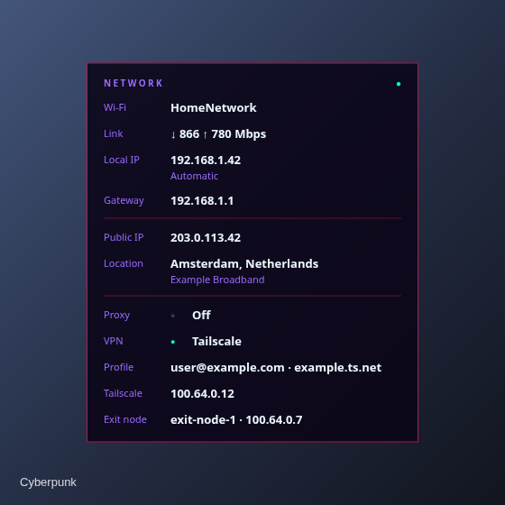 | 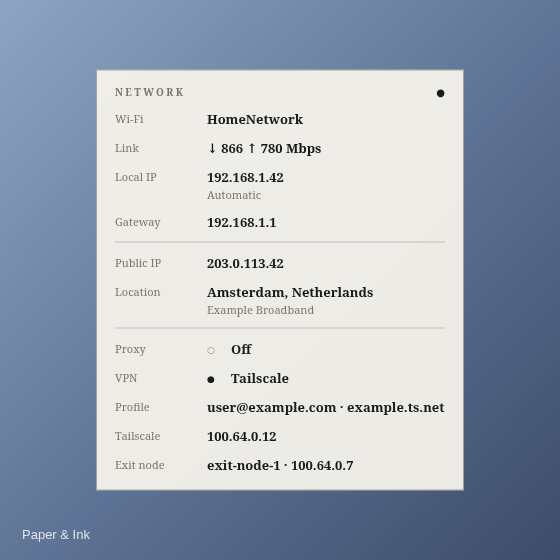 | 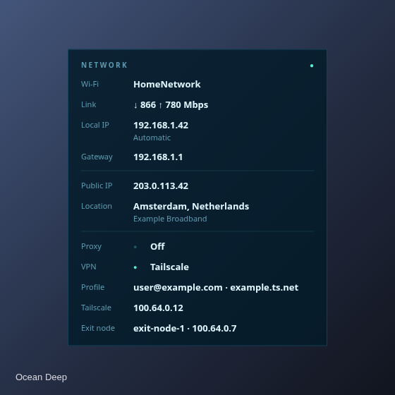 |
| 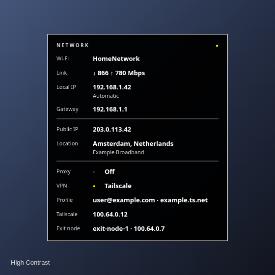 | | |

</details>

## Development

```sh
make pack       # build dist/*.shell-extension.zip
make previews   # re-render docs/screenshots (needs Node and Chromium)
```

Layout: `extension.js` (widget and data), `prefs.js` (settings window), `themes.js` (palettes), `schemas/` (GSettings).

## License

MIT. See [LICENSE](LICENSE).

## Author

AI Slop by psychoSherlock
